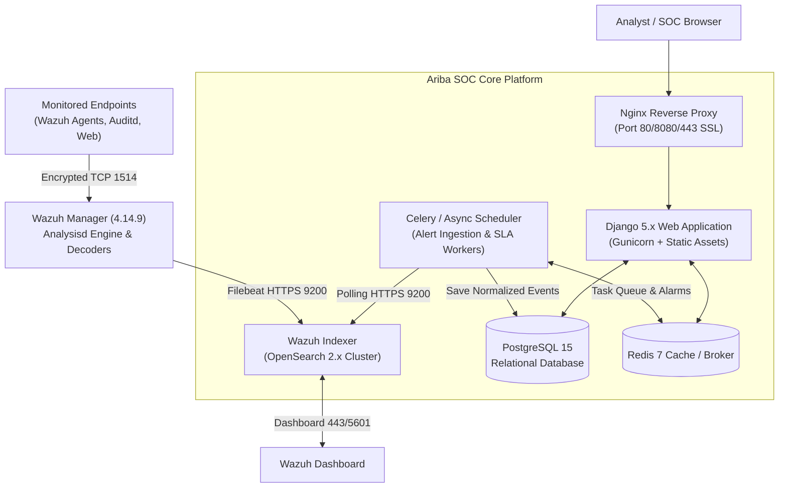

# 💻 Developer Guide: 01. System Architecture

## 1. High-Level Architecture Overview
Ariba SOC is built on an enterprise asynchronous microservice architecture comprising:

---

## 2. Core Service Components
- **`web`**: Django 5.x core application served via Gunicorn. Handles REST APIs, RBAC, Alert Cockpit, Kanban Board, PDF generation.
- **`scheduler`**: Asynchronous worker running periodic sync tasks:
  - Polling Wazuh Indexer (`wazuh-alerts-*`) every 10m/1m.
  - SLA breach evaluation and escalation engine.
  - Automated report generation and database pruning.
- **`db`**: PostgreSQL 15 database storing alerts, assets, audit trails, incidents, and settings.
- **`redis`**: In-memory broker handling real-time audio/visual alarm states, session caches, and Celery locks.
- **`nginx`**: Front-facing web server providing SSL termination, static file serving, and gzip compression.
