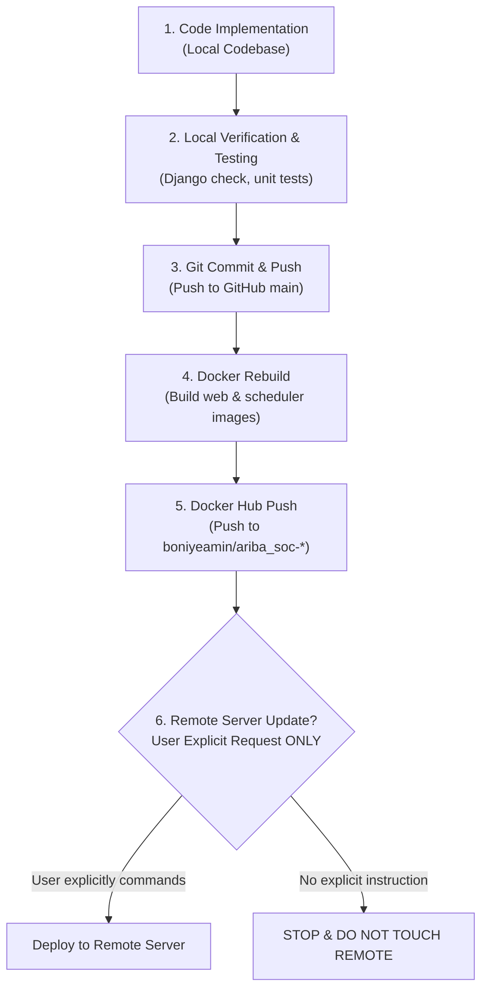

# 💻 Developer Guide: 03. Workflow & CI/CD Pipeline Rules

Ariba SOC enforces strict development and deployment pipeline rules (see also [WORKFLOW_RULES.md](file:///home/boni/Desktop/ariba_soc-main/WORKFLOW_RULES.md)).



---

## 📌 The 6-Step Standard Procedure

### Step 1: Code Implementation
- All modifications, bug fixes, UI improvements, and feature developments must be done locally in the repository.

### Step 2: Testing & Verification
- Execute Django checks and unit tests inside the local container:
  ```bash
  docker exec infrastructure-web-1 python manage.py check
  docker exec infrastructure-web-1 python manage.py test alerts wazuh_integration
  ```

### Step 3: Git Commit & Push
- Stage changes and make a conventional commit:
  ```bash
  git add .
  git commit -m "feat/fix: detailed explanation"
  git push origin main
  ```

### Step 4: Docker Rebuild
- Rebuild the local Docker images:
  ```bash
  docker build -t boniyeamin/ariba_soc-web:latest ./ariba_soc
  docker tag boniyeamin/ariba_soc-web:latest boniyeamin/ariba_soc-scheduler:latest
  ```

### Step 5: Docker Hub Push
- Push the newly verified images to Docker Hub:
  ```bash
  docker push boniyeamin/ariba_soc-web:latest
  docker push boniyeamin/ariba_soc-scheduler:latest
  ```

### Step 6: Remote Server Policy
> [!CAUTION]
> **NEVER touch, connect to, or update the remote server unless the USER explicitly commands it.**
> Stop after Step 5 and inform the user that Docker Hub is updated and ready.
