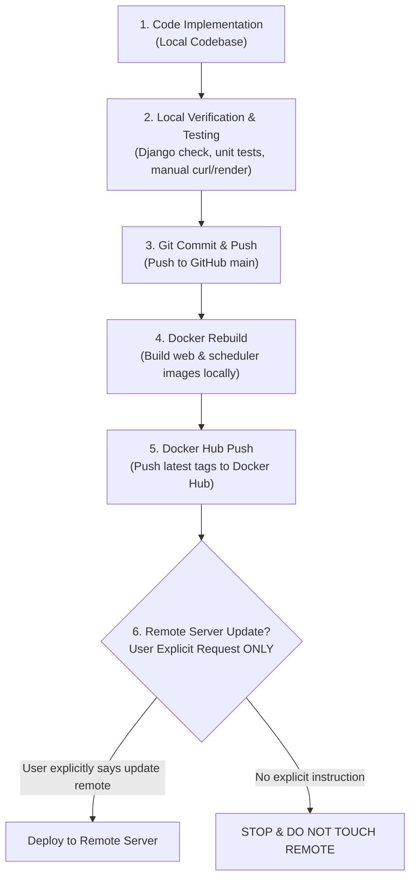

# Ariba SOC - Standard Development & Deployment Workflow

Strict adherence to the following sequence is required for all development, builds, and deployments:

---

## 📌 Strict Step-by-Step Pipeline



---

### Step 1: Code Implementation
- All modifications, bug fixes, UI improvements, and feature developments must be done locally in the repository.

### Step 2: Testing & Verification
- Execute Django checks:
  ```bash
  docker exec infrastructure-web-1 python manage.py check
  ```
- Run unit tests or feature validations:
  ```bash
  docker exec infrastructure-web-1 python manage.py test
  ```
- Verify web endpoints / templates / reports inside the container before proceeding.

### Step 3: Git Commit & Push
- Stage changes and make a descriptive conventional commit.
- Push changes to GitHub repository:
  ```bash
  git push origin main
  ```

### Step 4: Docker Rebuild
- Rebuild the local Docker images:
  ```bash
  docker build -t boniyeamin/ariba_soc-web:latest ./ariba_soc
  docker tag boniyeamin/ariba_soc-web:latest boniyeamin/ariba_soc-scheduler:latest
  ```
  *(Or use `cd infrastructure && docker compose build web scheduler`)*

### Step 5: Docker Push
- Push the newly built and verified images to Docker Hub:
  ```bash
  docker push boniyeamin/ariba_soc-web:latest
  docker push boniyeamin/ariba_soc-scheduler:latest
  ```

### Step 6: Remote Server Update Policy
> [!CAUTION]
> **NEVER touch, connect to, or update the remote server unless the USER explicitly requests it.**
> If the user has not explicitly commanded to update the remote server, stop after Step 5 and inform the user that Docker Hub is updated and ready.
