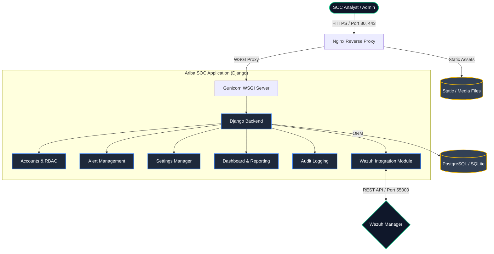

# Platform Architecture Guide

This document outlines the high-level text-based architecture of the Ariba SOC platform.

## High-Level Architecture Diagram



## Directory Structure Architecture

Below is the standard ASCII representation of the core project structure:

```text
ariba_soc/
├── config/                 # Main Django project settings & URLs
│   ├── settings.py
│   ├── urls.py
│   └── wsgi.py
├── accounts/               # User profiles, RBAC, and Authentication
├── alerts/                 # Alert ingestion, Kanban board, Triage logic
├── audit/                  # Platform-wide action auditing
├── dashboard/              # KPI metrics and analytics
├── reports/                # PDF/CSV generation
├── settings_manager/       # Centralized SOC configuration
├── wazuh_integration/      # Wazuh API client and sync logic
├── templates/              # Global UI templates (base.html, etc.)
├── static/                 # CSS (ariba-soc.css), JS, and vendor assets
├── media/                  # User avatars and uploaded files
├── docs/                   # Platform documentation
│   └── guide/              # This directory
├── .env                    # Environment variables (DB credentials, API keys)
├── manage.py               # Django execution script
└── requirements.txt        # Python dependencies
```

## Component Breakdown

1. **Nginx & Gunicorn (Web Layer):** Nginx acts as the reverse proxy, serving static files efficiently and forwarding dynamic application requests to Gunicorn, which runs the Django WSGI application.
2. **Django Backend (Core Layer):** Contains modular apps ensuring separation of concerns. `alerts` handles the SOC operational workflow, `settings_manager` dynamically configures platform rules, and `accounts` enforces Role-Based Access Control (RBAC).
3. **Database (Persistence Layer):** Stores all internal state, including alert histories, user profiles, audit logs, and configuration matrices.
4. **Wazuh Manager (Integration Layer):** The external SIEM engine. Ariba SOC periodically polls the Wazuh REST API via the `wazuh_integration` module to fetch new security events and translate them into actionable SOC alerts.
