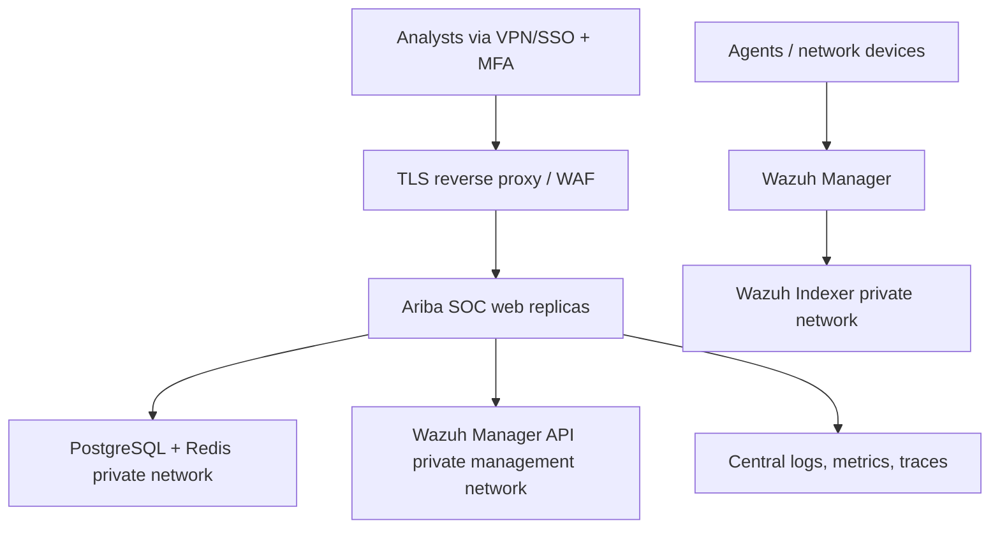

# Ariba SOC — Code, Infrastructure, and SOC L1–L3 Dashboard Audit

**Audit date:** 2026-09-05  
**Reviewed artifact:** `ariba_soc-main.zip`  
**Method:** Offline source review, configuration review, Python compilation, Django system checks, and test execution. No active testing of production hosts was performed.

## Executive summary

The project has a useful Django-based SOC foundation: Wazuh ingestion, alert assignment, comments, escalation, audit history, reporting, a monitor wallboard, Docker packaging, CI workflows, and encrypted Wazuh credentials. It is not production-ready yet.

The largest risks are broken authorization boundaries, secrets packaged inside the ZIP, insecure production defaults, direct exposure of Wazuh management services, and an alert workflow that does not enforce legal state transitions. The current product models L1 and L2 but has no explicit L3 role, queue, workflow ownership, or role-specific dashboard. A single shared dashboard exposes organization-wide data to every authenticated user.

**Overall risk:** High  
**Recommended release decision:** Do not expose to the Internet or deploy as a production SOC case-management system until all Critical and High findings are fixed and retested.

## Validation results

| Check | Result |
|---|---|
| ZIP path safety | Pass: 1,084 entries; no absolute or `../` paths |
| Python syntax compilation | Pass |
| Django migrations in test DB | Pass |
| Django tests | Fail: 19 passed, 2 collection/import errors |
| Django deployment check under current development settings | 6 security warnings |
| Live infrastructure test | Not performed |

The two failing test modules execute database/network operations during import. One can print a decrypted Wazuh password. Test discovery also attempted to reach the configured Wazuh manager, demonstrating that the suite is not isolated.

## Prioritized findings

### Critical

#### C-01 — Authorization is missing from alert and dashboard read endpoints

**Evidence:** `alerts/views.py` lines 24–152 and 307–316 use only `login_required`; `dashboard/views.py` lines 11–56 and `monitor/views.py` lines 7–22 do the same. `RolePermission.can_view_alerts` exists but is not checked. A VIEWER, disabled analyst profile, or any authenticated account can query all alerts, raw event details, usernames, IPs, comments, audit history, analyst workload, and global statistics.

**Fix:** Introduce a central permission decorator/mixin and queryset scope. Enforce `can_view_alerts`, team/tenant/business-unit scope, and object-level access on HTML and JSON endpoints. Return 403 for APIs. Add deny-by-default tests for every role and route.

#### C-02 — Unauthorized alert state changes

**Evidence:** `alerts/views.py` lines 278–293 reopen alerts without a permission check. Lines 381–395 let any authenticated non-MONITOR user move an alert to any active status. Lines 346–375 accept arbitrary bulk status/verdict values and bypass model `save()` through `QuerySet.update()`. Read-only roles can therefore alter cases and audit meaning.

**Fix:** Use a state-machine service for every single and bulk transition. Validate actor role, current state, destination state, mandatory evidence, assignee ownership, and concurrency version inside `transaction.atomic()` with `select_for_update()`.

#### C-03 — Secrets were packaged in the supplied ZIP

**Evidence:** The ZIP contains untracked `ariba_soc/.env` and `infrastructure/.env` with populated Django, database, Wazuh, indexer, dashboard, admin, and email secret fields. Values were not copied into this report.

**Fix:** Treat all values as compromised: rotate them, revoke old credentials/tokens, change admin passwords, and review access logs. Never distribute `.git` or `.env`. Build release archives from `git archive` or a CI artifact allow-list. Add secret scanning to both current files and Git history.

#### C-04 — Test code can disclose credentials and contact real infrastructure

**Evidence:** `tests/unit/test_crypto.py` lines 6–9 reads the real configuration and prints the decrypted Manager password. `test_fetch.py`, `test_idx.py`, and `test_wazuh_api.py` run network/database actions at import time. Test discovery attempted connection to `10.24.66.2`.

**Fix:** Remove credential output immediately. Convert scripts to proper mocked tests. Block network by default in unit tests, inject fake clients, use dedicated test settings, and never load project `.env` during CI tests.

### High

#### H-01 — Production configuration serves the SOC application over HTTP

**Evidence:** `infrastructure/config/nginx.docker.conf` listens only on port 80. `docker-compose.prod.yml` publishes `${HTTP_PORT:-8080}:80`. Current `.env` indicates HTTPS disabled, wildcard hosts, and debug enabled. Sessions and CSRF cookies are therefore not Secure and HSTS is disabled.

**Fix:** Terminate TLS on a controlled reverse proxy, redirect HTTP to HTTPS, set `DJANGO_DEBUG=False`, explicit `DJANGO_ALLOWED_HOSTS`, `DJANGO_USE_HTTPS=True`, trusted proxy header, secure cookies, HSTS after validation, and narrow CSRF origins.

#### H-02 — Wazuh Manager API and Indexer are directly published on all host interfaces

**Evidence:** `infrastructure/docker-compose.prod.yml` publishes ports 55000 and 9200 without an IP bind. Dashboard 8443 is also directly published. Only agent enrollment/event ports normally require broader network reach.

**Fix:** Remove the Indexer `9200` host mapping. Keep Manager API `55000` internal or bind it to a management VLAN address/firewall allow-list. Put dashboard access behind VPN/SSO/reverse proxy. Restrict 1514/1515/514 to agent networks. Segment frontend, application, data, and management Docker networks.

#### H-03 — TLS verification is disabled by default for Wazuh and Indexer clients

**Evidence:** `config/settings.py` defaults `WAZUH_VERIFY_SSL` to false; `wazuh_integration/models.py` lines 20–44 defaults both stored configurations to false; supplied environment files also disable verification.

**Fix:** Make verification true by default, mount the private CA bundle, support an explicit CA path, fail closed on certificate errors, and remove insecure UI defaults.

#### H-04 — No explicit SOC L3 role or L1→L2→L3 workflow

**Evidence:** `accounts/models.py` defines L1 and L2 but no L3. Escalation maps `SOC_ENG` to IR/IT, which is a different function. The status list moves from L2 to IR/IT or Management and does not record tier ownership.

**Fix:** Add `L3` as a distinct analyst role. Separate functional role from support tier. Model escalation as records, not only status text: source tier, target tier/team, reason, severity, SLA, accepted_by/at, returned_by/at, decision, and linked incident.

#### H-05 — Settings access is role-name based and over-privileged

**Evidence:** `settings_manager/views.py` lines 23–34 grants the entire settings area to a configurable role list. SOC Engineer can reach user management and role-permission editing despite granular `can_manage_users` and `can_manage_wazuh` fields existing.

**Fix:** Enforce the specific permission required for each view. Protect superuser/admin role changes from privilege escalation. Require re-authentication/MFA for credential, role, password, and Wazuh configuration changes.

#### H-06 — Workflow integrity and race conditions are not controlled

**Evidence:** Assignment, close, reopen, escalation, bulk actions, and auto-escalation use separate reads/writes without row locking or a version field. Two analysts can overwrite each other. Free-form status strings mix lifecycle, escalation destination, and remediation phase.

**Fix:** Add `version`, `current_owner_team`, `current_tier`, and normalized state. Perform transitions in atomic transactions, reject stale versions, and emit an immutable event for each transition.

#### H-07 — Audit evidence is mutable/deletable and incomplete

**Evidence:** `AlertAuditLog` cascades when an alert is deleted. Bulk `update()` bypasses timestamps/model logic and records a combined old value instead of each alert's actual old value. IP capture uses `REMOTE_ADDR` even behind a proxy. Notification failures are swallowed.

**Fix:** Make audit events append-only with `PROTECT`/retention archive, per-record before/after JSON, request/correlation ID, trusted client IP handling, hash chaining or external immutable log export, and monitored notification delivery status.

#### H-08 — Container supply-chain reproducibility is weak

**Evidence:** Production uses `boniyeamin/ariba_soc-web:latest`, scheduler `:latest`, and major/minor base tags such as Wazuh 4.9.0/Postgres 15/Redis 7/Nginx 1.27. A deploy can silently change artifacts.

**Fix:** Pin images by digest, generate an SBOM, sign images, verify signatures in deployment, run vulnerability scanning on every build, and promote the same immutable digest through environments.

### Medium

#### M-01 — Test suite is small and currently fails

There are only basic model tests and no meaningful route-level authorization matrix, transition tests, concurrency tests, ingestion contract tests, or dashboard metric tests. Fix the two import errors and make CI fail on warnings/test failures.

#### M-02 — Dashboard queries will degrade with alert volume

`dashboard_stats_api()` performs a query per day; wallboard metrics run many global counts every refresh; `resolve_globe_arcs()` adds one query per source IP and synchronous external geolocation calls. There is no scoped aggregation layer.

Use minute/hour summary tables, Redis caching, background aggregation, database conditional aggregates, and batch GeoIP using a local database. Establish latency and freshness SLOs.

#### M-03 — GeoIP sends source IPs to a third-party service over plaintext HTTP

`monitor/services.py` calls `http://ip-api.com/json/{ip}`. This leaks observed public IPs and can be tampered with.

Use a locally hosted MaxMind-compatible GeoIP database or an approved HTTPS provider with privacy review. Never let GeoIP block a dashboard request.

#### M-04 — Incident data is inferred from alerts instead of modeled

The wallboard treats escalated Critical/High alerts as incidents. This prevents grouping related alerts, ownership, business impact, timeline, containment, evidence, and post-incident review.

Create `Incident`, `IncidentAlert`, `IncidentTask`, `IncidentTimeline`, and `Evidence` models. Promote alerts into an incident through an authorized workflow.

#### M-05 — SLA metric semantics are incomplete

The model calculates only a resolution deadline even though settings include acknowledge and resolve minutes. `status_updated_at` uses `auto_now_add`, so it does not track later status updates. Dashboard “response time” is acknowledgement time, not containment or resolution time.

Store separate acknowledge, triage, escalation, containment, remediation, and resolution targets/timestamps. Freeze the applicable SLA policy version on case creation.

#### M-06 — Dashboard “health score” is not decision-grade

The score subtracts fixed values from 100 and quickly clamps to zero as alert volume grows. It is not normalized by asset count, business criticality, baseline, coverage, or time window.

Rename it to an experimental risk indicator or replace it with transparent KPIs: open risk-weighted backlog, critical SLA breach rate, coverage, sensor health, vulnerability exposure, and incident trend.

#### M-07 — Operational scripts create unsafe network exposure

`scripts/fix_firewall.py` disables SSH host-key verification and opens Indexer port 9200 broadly in firewalld, UFW, and iptables. `fix_wazuh.py` binds Indexer to `0.0.0.0`.

Remove these scripts from production artifacts. Replace them with reviewed configuration management that uses SSH keys, verified host keys, explicit source CIDRs, idempotent rules, and change records.

#### M-08 — Production resilience controls are incomplete

The stack is single-node, uses a bind-mounted PostgreSQL data directory, has no demonstrated encrypted off-host backups, restore drills, HA, capacity thresholds, or disaster-recovery objectives.

Define RPO/RTO, encrypted automated backups, quarterly restore testing, storage/retention sizing, monitoring for queue/index lag, and a documented degraded-mode procedure.

## Recommended L1–L3 operating workflow

| Stage | Primary owner | Required action | Exit criteria |
|---|---|---|---|
| New / Untriaged | L1 queue | Validate source, enrich IOC, deduplicate, set asset/business context | TP/FP/Benign/Suspicious decision with evidence |
| Investigating L1 | Named L1 | Basic timeline, user/host checks, containment recommendation | Close if authorized low-risk case, or escalate to L2 |
| Escalated / Awaiting acceptance | L2 queue | Accept/return with reason; SLA continues | L2 owner recorded |
| Deep investigation | L2 | Correlation, scope, hunt, containment coordination | Resolve, create incident, or escalate to L3 |
| Advanced investigation | L3 queue | Forensics, malware analysis, detection gap, root cause | Containment/remediation plan and confidence level |
| Incident response | IR lead | Coordinate business/IT owners and evidence | Contained, eradicated, recovered |
| Closure review | L2/L3 or Manager | Verify evidence, classification, SLA, lesson learned | Closed and immutable review event |
| Detection improvement | SOC Engineer | Tune rule/playbook and measure recurrence | Tested rule change linked to case |

Do not represent “L2 pending” by inserting a fake approval/history row. Store the actual escalation event, set the case's current queue/tier to L2, and derive “L2 Pending Acceptance” from current state plus the absence of an acceptance event.

## Role-specific dashboards

### L1 dashboard — triage and queue control

- My assigned alerts; unassigned L1 queue; newest Critical/High first.
- Acknowledge SLA countdown, near-breach and breached queue.
- Required triage checklist, enrichment summary, duplicate/correlation hints.
- One-click claim, evidence note, verdict, and escalation to L2.
- Shift metrics: acknowledged, triaged, escalated, false-positive rate, handover pending.

### L2 dashboard — investigation and escalation control

- L2 pending acceptance, returned cases, active investigations, L1 escalations by reason.
- Correlated alerts by user/host/rule/source IP; timeline and blast-radius view.
- Incident candidates, containment tasks, IR/IT coordination, L3 escalation.
- Metrics: MTTA after escalation, investigation age, containment time, reopen rate, L1 return reasons.

### L3 dashboard — advanced analysis and quality

- High-complexity queue, active incidents, malware/forensics tasks, hunt hypotheses.
- Evidence chain, affected assets, MITRE coverage, detection gaps, rule-tuning backlog.
- Root-cause and lessons-learned review, recurrence tracking, detection validation.
- Metrics: time to containment, time to root cause, recurrence, tuning effectiveness, incident severity trend.

### Manager dashboard — governance, not analyst workload alone

- Risk-weighted open backlog, critical SLA breaches, incident status, business-unit risk.
- Coverage: agents online/offline, log-source freshness, ingestion lag, dropped events.
- Staffing: queue age by tier and shift, workload balance, handover health.
- Quality: false-positive rate by rule, reopen rate, escalation acceptance, closure QA.
- Trends with explicit time windows and drill-down to underlying cases.

## Data model changes required

Add these core entities rather than continuing to overload `Alert.status`:

1. `Case` or enhanced `Alert`: current state, current tier, owner team, owner user, version, business unit, asset criticality, classification.
2. `CaseTransition`: from/to state, actor, reason, evidence, timestamp, request ID, source/target tier.
3. `Escalation`: target tier/team, acceptance state, accepted/returned actor and timestamps, SLA target.
4. `Incident` and `IncidentAlert`: multiple correlated alerts per incident.
5. `SLAInstance`: policy snapshot and separate acknowledge/triage/contain/resolve targets.
6. `ShiftHandover`: outgoing/incoming analysts, unresolved cases, acknowledgement.
7. `IntegrationHealth`: source freshness, last success/error, lag, event counts.
8. `NotificationDelivery`: channel, attempt, result, error, retry schedule.

## Infrastructure target state

Minimum controls: management VLAN/VPN, MFA/SSO, TLS everywhere, strict firewall allow-lists, separate Docker networks, no public Indexer port, immutable images, secrets manager, encrypted backups, centralized audit export, NTP, monitoring, and documented DR.

## 30/60/90-day improvement plan

### Days 0–7: emergency remediation

1. Rotate all secrets found in the ZIP and invalidate old sessions/tokens.
2. Remove `.env`, `.git`, credential-printing tests, and unsafe firewall scripts from release artifacts.
3. Restrict 9200/55000/8443 at host and network firewalls.
4. Disable debug/wildcard hosts; enable HTTPS and secure cookies.
5. Block unauthorized read, reopen, drag/drop, bulk status, and dashboard APIs.

### Days 8–30: workflow integrity

1. Build centralized permission and queryset scoping with an automated role-route matrix.
2. Implement legal state transitions, transactions, row locking/version checks, and immutable transition events.
3. Add L3, escalation acceptance/return, incident modeling, and separate tier queues.
4. Repair and isolate the test suite; add security regression tests.
5. Pin and scan container images; generate SBOMs.

### Days 31–60: dashboards and operations

1. Deliver distinct L1, L2, L3, and Manager dashboards.
2. Add SLA instances, shift handover, integration freshness, queue age, and business context.
3. Replace synchronous third-party GeoIP with a local asynchronous enrichment pipeline.
4. Add aggregation tables/cache and dashboard freshness indicators.

### Days 61–90: resilience and maturity

1. Implement SSO/MFA, privileged-action re-authentication, and access reviews.
2. Export audit logs to immutable centralized storage and alert on administrative changes.
3. Define RPO/RTO, automate encrypted backups, and perform a documented restore exercise.
4. Add incident playbooks, closure QA, detection tuning lifecycle, KPIs, and quarterly tabletop exercises.

## Release gates

Production approval should require all of the following:

- Zero Critical/High authorization findings in retest.
- No secrets in working tree, artifact, image layers, or Git history.
- HTTPS and certificate verification enforced.
- Role-route-object authorization tests for L1/L2/L3/Manager/Engineer/Admin/Viewer/Monitor.
- State-transition and concurrency tests passing.
- All tests isolated from production and passing.
- Indexer and management APIs unreachable from unapproved networks.
- Backup restore successfully demonstrated.
- Dashboard KPIs have written definitions, source fields, time windows, and freshness limits.

## Positive foundations to retain

- Credentials stored in database use an encrypted custom field with a separate cryptography key.
- The application already has role-permission records, alert audit records, SLA settings, escalation rules, and notification settings that can be evolved.
- Wazuh clients use reusable HTTP sessions and token retry logic.
- Docker runs the Django application as a non-root user.
- The repository includes CI/security workflows and operational documentation; these should be tightened into enforceable release gates.

## Audit limitations

This review did not include production host configuration, firewall rules, deployed container/image contents, database contents, network packet inspection, authenticated dynamic testing, SAST/DAST output, dependency CVE verification, load testing, backup restoration, or Wazuh rule quality. Findings are based on the supplied archive and safe local execution only.
