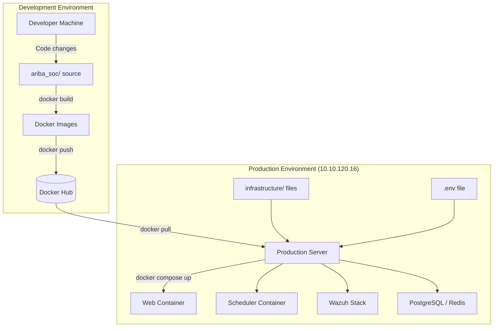

# Ariba SOC Production Deployment Guide

## 1. Overview
This document provides a comprehensive workflow for deploying the Ariba SOC application alongside the Wazuh stack into a production environment. 

The primary goal of this architecture is to separate the **source code** from the **production server**. The application source code (`ariba_soc/`) remains strictly on the development/build machine. The production server is provisioned solely with the `infrastructure/` directory, utilizing pre-built Docker Hub images.

## 2. Deployment Architecture



### Key Principles
* **Immutable Artifacts**: Application containers start from version-pinned Docker Hub images.
* **Separation of Concerns**: The production server only receives the deployment manifests (`docker-compose.yml`), scripts, and configurations.
* **Secret Management**: Passwords and secrets exist only in the `.env` file on the deployment server and are never committed to version control or baked into images.

## 3. Prerequisites

### Development / Build Machine
* Docker and Docker Compose installed.
* Access to the full Git repository (`ariba_soc/` and `infrastructure/`).
* Authenticated access to Docker Hub (`docker login`).

### Production Server (e.g., `10.10.120.16`)
* SSH access.
* Root or `sudo` privileges.
* Docker and Docker Compose installed (or the ability to run `./scripts/install-docker.sh`).
* Outbound internet access to pull images from Docker Hub and Wazuh registries.
* Hardware requirements: Minimum 4 vCPUs, 8GB RAM (16GB recommended due to OpenSearch/Wazuh Indexer).

## 4. Repository and Infrastructure Layout

The deployment package sent to the production server should strictly contain the contents of the `infrastructure/` directory:

```text
infrastructure/
├── docker-compose.yml       # Primary deployment manifest
├── .env.example             # Template for required secrets
├── config/                  # Wazuh and Nginx static configurations
└── scripts/
    ├── setup.sh             # Initial provisioning script
    ├── health-check.sh      # Service verification
    ├── backup.sh            # Database and config backup
    └── restore.sh           # Restoration script
```

## 5. Docker Hub Image Strategy

To ensure repeatable and reliable deployments, always use **immutable version tags** rather than relying exclusively on `latest`.

* **Web Application**: `<DOCKERHUB_USERNAME>/ariba_soc-web:<VERSION>`
* **Scheduler**: `<DOCKERHUB_USERNAME>/ariba_soc-scheduler:<VERSION>`

*Example Tags:* `1.0.0`, `1.0.1`, `1.1.0`.

## 6. Building and Publishing Images

On your **Development Machine**, execute the following workflow to release a new version.

1. **Develop and Test**: Verify the code locally.
2. **Build and Tag Images**:
   ```bash
   cd infrastructure
   
   # Build the images
   docker compose build web scheduler
   
   # Tag the images with a version
   docker tag <DOCKERHUB_USERNAME>/ariba_soc-web:latest <DOCKERHUB_USERNAME>/ariba_soc-web:1.0.0
   docker tag <DOCKERHUB_USERNAME>/ariba_soc-scheduler:latest <DOCKERHUB_USERNAME>/ariba_soc-scheduler:1.0.0
   ```
3. **Push to Docker Hub**:
   ```bash
   docker push <DOCKERHUB_USERNAME>/ariba_soc-web:1.0.0
   docker push <DOCKERHUB_USERNAME>/ariba_soc-scheduler:1.0.0
   ```

## 7. Preparing the Production Server

Connect to the internal/private production server:
```bash
ssh <user>@10.10.120.16
```

### 7.1 Transfer Infrastructure Files
Clone or securely transfer the `infrastructure` directory to the server. Do not include the `ariba_soc` folder.

```bash
git clone <INFRASTRUCTURE_REPOSITORY_URL>
cd infrastructure
```

### 7.2 System Requirements (Wazuh Indexer)
> [!IMPORTANT]
> Wazuh Indexer requires a higher `vm.max_map_count`. The `./scripts/setup.sh` will check this, but you must configure it first.

```bash
sudo sysctl -w vm.max_map_count=262144
echo "vm.max_map_count=262144" | sudo tee -a /etc/sysctl.conf
```

### 7.3 Modify Docker Compose (Production Preparation)
> [!NOTE]
> **TODO / Future Improvement:** Currently, the `infrastructure/docker-compose.yml` file contains `build: ../ariba_soc` directives for the `web` and `scheduler` services. 

Before deploying on production, you must edit `docker-compose.yml` and **remove or comment out** the `build: ../ariba_soc` lines, and ensure the `image:` uses your specific version tag.

```yaml
  web:
    image: <DOCKERHUB_USERNAME>/ariba_soc-web:1.0.0
    # build: ../ariba_soc  <-- Remove this
```

## 8. Environment Configuration

The `.env` file contains critical production secrets. **It must never be committed to version control.**

```bash
cp .env.example .env
nano .env
```

Ensure all passwords (`DATABASE_PASSWORD`, `WAZUH_API_PASSWORD`, etc.) are generated as cryptographically strong, unique values.

Secure the file permissions:
```bash
chmod 600 .env
```

## 9. First-Time Deployment

Execute the setup script. This script validates the `max_map_count`, generates Wazuh Indexer SSL certificates via a temporary container, and starts the stack.

```bash
chmod +x scripts/*.sh
./scripts/setup.sh
```

> [!WARNING]
> **Behavior Note:** `setup.sh` currently executes `docker compose up --build -d`. If you have correctly removed the `build:` directives from `docker-compose.yml`, the `--build` flag will be safely ignored, and Docker will pull the images from Docker Hub.

## 10. Deployment Verification

Once the containers are created, wait 1-2 minutes for the databases and Wazuh Indexer to initialize.

### 10.1 Container Status
Verify all services report as `Up` (or `Healthy`):
```bash
docker compose ps
```

### 10.2 Automated Health Check
Run the provided health check script to verify HTTP responses across the Wazuh API, Indexer, and Ariba SOC dashboard:
```bash
./scripts/health-check.sh
```

### 10.3 Django Application Checks
You can verify the Django backend directly inside the running container:
```bash
# Check for deployment misconfigurations
docker compose exec web python manage.py check --deploy

# Ensure no unapplied migrations exist
docker compose exec web python manage.py makemigrations --check --dry-run
```

## 11. Updating the Application

When a new version (e.g., `1.0.1`) is pushed to Docker Hub from the development machine, update the production server safely:

1. SSH into the production server.
2. Edit `infrastructure/docker-compose.yml` to update the image tags to `1.0.1`.
3. Pull the new images:
   ```bash
   docker compose pull web scheduler
   ```
4. Recreate the specific containers (this is idempotent and will not destroy persistent data volumes):
   ```bash
   docker compose up -d web scheduler nginx
   ```
5. Run the health check: `./scripts/health-check.sh`

## 12. Rollback Procedure

If the new deployment fails health checks or introduces critical bugs, rollback immediately to the previous known-good tag.

1. Edit `infrastructure/docker-compose.yml` and revert the image tag back to `1.0.0`.
2. Re-deploy the containers:
   ```bash
   docker compose up -d web scheduler nginx
   ```
3. Verify stability with `./scripts/health-check.sh`.

> [!CAUTION]
> **NEVER run `docker compose down -v`** in a production environment unless you intend to permanently destroy the PostgreSQL database, Wazuh logs, and Redis caches.

## 13. Backup and Restore

### Backup
Execute the backup script to create a timestamped archive of the PostgreSQL database and Wazuh configurations:
```bash
./scripts/backup.sh
```
*Output location:* `infrastructure/backups/<TIMESTAMP>/`

### Restore
To restore a previous backup, provide the exact timestamp directory name:
```bash
./scripts/restore.sh <TIMESTAMP>
```
*Note:* The restore script temporarily stops the `web` and `scheduler` services to safely drop and recreate the PostgreSQL database from the SQL dump, then restarts them.

## 14. Monitoring and Logs

To monitor application behavior in real-time:

```bash
# View combined logs for the web and scheduler containers
docker compose logs -f --tail=100 web scheduler

# View Wazuh Manager logs
docker compose logs -f --tail=100 wazuh.manager
```

## 15. Security Requirements

### Production Security Checklist
- [ ] **No secrets in Git**: Confirmed `.env` is ignored.
- [ ] **No secrets in Docker images**: Code does not bake credentials into the `Dockerfile`.
- [ ] **.env protected**: File permissions set to `600`.
- [ ] **Production credentials rotated**: Default passwords in `.env.example` must be changed.
- [ ] **HTTPS/TLS configured**: Wazuh Dashboard and APIs use TLS (Self-signed certs generated by `generate-indexer-certs.yml`). *TODO: Implement production CA certificates.*
- [ ] **ALLOWED_HOSTS restricted**: Ensure `ALLOWED_HOSTS` in `.env` only contains the production IP/Domain.
- [ ] **Persistent data backed up**: Use a cron job to automate `./scripts/backup.sh`.
- [ ] **Docker images version-pinned**: `docker-compose.yml` utilizes explicit version tags.

## 16. Troubleshooting

| Issue | Diagnosis & Resolution |
| :--- | :--- |
| **Wazuh Indexer crash loop** | Run `sysctl vm.max_map_count`. If it is below `262144`, update it and restart the container. |
| **Container unhealthy (web)** | Run `docker compose logs --tail=50 web`. Check if the database connection failed due to wrong credentials in `.env`. |
| **Setup script fails with API timeout** | The Wazuh Indexer takes ~2 minutes to boot. The setup script's seed process may time out. Run `docker compose exec web python seed_wazuh_config.py` manually once `health-check.sh` passes. |
| **Image pull failure** | Ensure the production server has outbound internet access. If the Docker Hub repository is private, run `docker login` on the server first. |
| **Ariba SOC Dashboard 502 Bad Gateway** | The `nginx` container cannot reach the `web` container. Ensure `web` is `Healthy`. Check logs via `docker compose logs nginx web`. |

## 17. Disaster Recovery
In the event of total server loss:
1. Provision a new server and fulfill the Prerequisites (Section 3).
2. Transfer the `infrastructure/` directory and the latest backup from `backups/<TIMESTAMP>`.
3. Restore the `.env` file from a secure password manager.
4. Run `./scripts/setup.sh` to initialize the containers.
5. Run `./scripts/restore.sh <TIMESTAMP>` to restore the database and configurations.

## 18. Future Improvements
* **CI/CD Integration**: Automate the build, tag, and push process (Section 6) using GitHub Actions.
* **Production Nginx**: Introduce valid Let's Encrypt SSL certificates for the Ariba SOC dashboard.
* **Separated Compose Files**: Implement `docker-compose.override.yml` for local builds, keeping `docker-compose.yml` strictly formatted for production image pulls.
