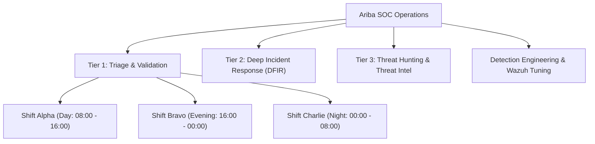

# Architecture & Implementation Plan: SOC Team Management System

**Document Version:** 1.0  
**Target Platform:** Ariba SOC Platform  
**Category:** User & Access / Operations Management  
**Status:** Architecture Proposal & Specification  

---

## 1. Executive Summary & Objective

In an enterprise-grade Security Operations Center (SOC), security analysts operate in coordinated teams across shifts (24/7/365) and functional domains (Tier-1 Triage, Tier-2 Deep Investigation/DFIR, Tier-3 Threat Hunting, and Detection Engineering). Currently, Ariba SOC relies on hardcoded string choices (`TEAM_CHOICES = ['L1', 'L2', 'L3', 'ENG', 'MANAGEMENT']`) within `AnalystProfile` and `Alert`.

This document specifies a **fully dynamic, industry-standard Team Management architecture**. It defines:
1. Dynamic Team data structures and shift scheduling models.
2. Team assignment, queue routing, and shift handover mechanisms.
3. Team-level MTTA/MTTR analytics and SLA accountability.
4. Granular role/team permissions and administrative UI in **Settings › User & Access**.
5. Phased, backward-compatible rollout plan.

---

## 2. Industry Standard SOC Team Taxonomy

A modern SOC organizes human capital into two orthogonal dimensions:
1. **Tier / Domain Teams (Functional)**: Grouped by operational capabilities.
2. **Shift Rosters (Temporal)**: Grouped by operational coverage windows.



---

## 3. Data Models & Database Architecture

To maintain relational integrity, high query performance, and backward compatibility, the dynamic team system introduces two core models in `accounts`:

### 3.1. `SocTeam` Model (`accounts/models.py`)

```python
class SocTeam(models.Model):
    name = models.CharField(max_length=100, unique=True)
    slug = models.SlugField(max_length=100, unique=True)
    description = models.TextField(blank=True)
    
    # Functional Classification
    TIER_CHOICES = [
        ('L1', 'Tier 1 - Triage & Initial Response'),
        ('L2', 'Tier 2 - Advanced Investigation & IR'),
        ('L3', 'Tier 3 - Threat Hunting & Forensics'),
        ('ENG', 'Detection Engineering & Wazuh'),
        ('MGMT', 'SOC Management & Governance'),
    ]
    tier = models.CharField(max_length=20, choices=TIER_CHOICES, default='L1')
    
    # Team Leadership & Ownership
    lead = models.ForeignKey(
        User, on_delete=models.SET_NULL, null=True, blank=True,
        related_name='led_teams'
    )
    
    # Shift / Roster Schedule
    SHIFT_CHOICES = [
        ('24x7', '24x7 Dedicated'),
        ('MORNING', 'Morning Shift (08:00 - 16:00)'),
        ('EVENING', 'Evening Shift (16:00 - 00:00)'),
        ('NIGHT', 'Night Shift (00:00 - 08:00)'),
        ('GENERAL', 'Standard Business Hours (09:00 - 18:00)'),
    ]
    shift_type = models.CharField(max_length=20, choices=SHIFT_CHOICES, default='GENERAL')
    shift_start_time = models.TimeField(null=True, blank=True)
    shift_end_time = models.TimeField(null=True, blank=True)
    
    # Notification & Escalation
    notification_email = models.EmailField(blank=True)
    webhook_url = models.URLField(blank=True, help_text='Slack/Teams/Webhook endpoint for team-level urgent alerts')
    
    # State & Metadata
    is_active = models.BooleanField(default=True)
    created_at = models.DateTimeField(auto_now_add=True)
    updated_at = models.DateTimeField(auto_now=True)

    class Meta:
        ordering = ['tier', 'name']
        verbose_name = 'SOC Team'
        verbose_name_plural = 'SOC Teams'

    def __str__(self):
        return f"{self.name} ({self.get_tier_display()})"
```

### 3.2. User Association (`AnalystProfile`)

```python
# In AnalystProfile:
team = models.ForeignKey(
    'SocTeam', on_delete=models.SET_NULL, null=True, blank=True,
    related_name='members'
)
# Secondary teams or cross-functional assignment:
secondary_teams = models.ManyToManyField(
    'SocTeam', blank=True, related_name='auxiliary_members'
)
```

### 3.3. Alert Assignment Association (`Alert`)

```python
# In Alert model:
assigned_team = models.ForeignKey(
    'accounts.SocTeam', on_delete=models.SET_NULL, null=True, blank=True,
    related_name='assigned_alerts',
    help_text='SOC Team responsible for triaging or remediating this alert'
)
```

---

## 4. SOC Operational Workflows

### 4.1. Team Queue & Alert Routing
1. **Unclaimed Queue by Team**: Alerts are routed to an entire team queue (e.g., `Shift Alpha - L1`).
2. **Claim/Assign within Team**: An analyst picks the alert from their team's queue.
3. **Escalation across Teams**: L1 team escalates directly to the L2 DFIR team queue without requiring a named individual at handoff time.

### 4.2. Shift Handover Protocol
At the end of Shift Alpha:
- The outgoing Team Lead runs **Shift Handover**:
  1. Identifies open, in-progress, and critical alerts.
  2. Generates an automated handover summary.
  3. Bulk-reassigns or transfers the alert queue to incoming Shift Bravo.
  4. Automatically logs the handover in the SOC Audit Trail.

### 4.3. Team Performance & Analytics
- **MTTA by Team**: Mean Time to Acknowledge broken down by Team and Shift.
- **MTTR by Team**: Mean Time to Resolve.
- **Workload Balance**: Number of active alerts per analyst across teams.

---

## 5. UI/UX Specification

### 5.1. Navigation (`Settings › User & Access`)
The sub-nav bar in User & Access will offer three tabs:
1. **Users** (`/settings/users/`): Existing user list with team badges.
2. **Teams** (`/settings/teams/`): Team Directory, Member rosters, Shift timings, Team Leads.
3. **Role & Permissions** (`/settings/roles/`): Matrix of permissions.

### 5.2. Team Directory Page (`/settings/teams/`)
* **KPI Metrics**: Total Teams, Active Teams, Analysts Assigned, Unassigned Analysts.
* **Team Cards / Grid**:
  * Team Name & Tier Badge (`L1`, `L2`, `L3`, `ENG`).
  * Team Lead avatar & name.
  * Member avatars with count badge.
  * Current Shift indicator (e.g., `🟢 Currently on Shift` vs `⚪ Off Duty`).
  * Action buttons: `Edit Team`, `View Members`, `Toggle Status`.

### 5.3. Team Detail / Members Modal
* Form to set Team Name, Tier, Shift, Team Lead, and Multi-select members.
* Quick member transfer (reassign analyst from Team A to Team B).

---

## 6. Phased Implementation Roadmap

| Phase | Milestone | Deliverables | Risk Level |
| :--- | :--- | :--- | :--- |
| **Phase 1** | **Model & Migration** | Create `SocTeam` model, foreign keys in `AnalystProfile` and `Alert`, write data migration to migrate existing legacy team strings (`L1`, `L2`) into initial `SocTeam` records. | Low (Non-breaking) |
| **Phase 2** | **Settings UI (CRUD)** | Build `Team Management` view in Settings, Team list, Create/Edit modals, team assignment in User Edit. | Low |
| **Phase 3** | **Alert Workflow Integration** | Add `assigned_team` filters on Alert Board, Alert Table, and Alert Detail triage modal. | Medium |
| **Phase 4** | **Analytics & Handover** | Team-based MTTA/MTTR breakdown in Reports, shift handover summary log. | Low |

---

## 7. Security & Access Control Matrix

| Role | View Teams | Create/Edit Teams | Assign Members | Shift Handover |
| :--- | :---: | :---: | :---: | :---: |
| **SOC Manager / Admin** | ✅ | ✅ | ✅ | ✅ |
| **Team Lead** | ✅ | ❌ | ✅ (Within Team) | ✅ |
| **L1 / L2 / L3 Analyst**| ✅ | ❌ | ❌ | ❌ |
| **Viewer / Monitor** | ✅ | ❌ | ❌ | ❌ |
